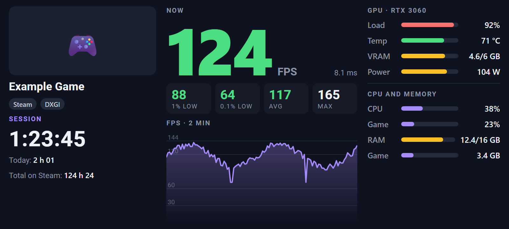

# PhoneBox Games Tab

**English** · [Português (Brasil)](README.pt-BR.md)

A **Games** page for [PhoneBox](https://github.com/ersinkoc/phonebox): while you play on your Windows PC, the phone on
your desk shows the live FPS, frame time, 1% / 0.1% lows, a 2-minute FPS chart, the game's cover art, the session timer,
today's play time and GPU / CPU / RAM load. When you are not playing it shows your recent sessions and the games you
played most this week.



> Community add-on. It is not part of PhoneBox and not affiliated with its author. It only uses PhoneBox's public
> local API (`/api/push`, `/api/settings`) and its **Custom HTML** widget, so the PhoneBox app and agent are unchanged.

## Features

- **FPS without overlays or injection.** Frames are counted from Windows' own real-time ETW events (DXGI, Direct3D 9
  and the DirectX kernel, which also covers Vulkan and OpenGL): the same data PresentMon and FrameView use. Nothing is
  hooked into the game, so anti-cheat systems are not involved. Works on any monitor and with any GPU.
- **Knows what you are playing.** Steam (name, cover, total hours on Steam), Xbox / Game Pass (official name and art
  from the Microsoft Store catalog), Epic, GOG and plain `.exe` games.
- **Play time.** Session timer, today's total, top games of the last 7 days, recent sessions with their average FPS.
- **Opens itself.** A PhoneBox rule switches the phone to the Games tab when a game starts and back when it ends.
- **Your lists.** Plain-text files to include or ignore programs and to add your own game folders.
- **English and Portuguese**, following the phone's language.

## Requirements

- Windows 10 or 11 and [PhoneBox](https://github.com/ersinkoc/phonebox) 0.9.24 or newer, with the agent running.
- The **.NET 10 SDK** to build the collector (or the .NET 10 Desktop Runtime if you use a prebuilt `bin` folder).
- For FPS, your Windows user must be in the **Performance Log Users** group (no administrator rights needed after
  that). An administrator adds it once with:

  ```powershell
  Add-LocalGroupMember -SID S-1-5-32-559 -Member $env:USERNAME
  ```

  then sign out and back in. Without it, play time and hardware still work and the tab says FPS is unavailable.

## Install

Download or clone this repository, then in PowerShell, as your normal Windows user:

```powershell
powershell -ExecutionPolicy Bypass -File .\install.ps1
```

The installer:

1. builds the collector into `bin\` (if it is not there yet);
2. finds your PhoneBox agent's port (the `--port` of your `PhoneBoxAgent.exe`, or 8765), backs up your PhoneBox
   settings to `%LOCALAPPDATA%\PhoneBoxGamesTab\`, and adds the **Games** page and the
   **Game running → Games tab** rule (`-NoRule` skips the rule);
3. creates the scheduled task **PhoneBox Games Tab**, which starts the collector at logon, hidden, without
   administrator rights, and restarts it if it crashes.

Open a game to try it. To remove everything: `.\install.ps1 -Uninstall`.

## Choosing what counts as a game

Every second the collector looks at the window in front. That program becomes the game when it draws at least
5 frames per second and the first matching rule says yes:

1. `ignore.txt`: never a game (always wins).
2. `include.txt`: always a game.
3. Microsoft Store / Xbox apps: only if the Store catalog lists them as a game (so WhatsApp, Netflix and similar apps
   are left out).
4. Usual game folders on any drive: `steamapps\common`, `Epic Games`, `XboxGames`, `GOG Games`,
   `Ubisoft Game Launcher\games`, `EA Games`, `Riot Games`, `Games`.
5. `folders.txt`: any program inside your own game folders (for example `D:\Games`).
6. Fullscreen: a window that covers its whole monitor.

Browsers, Discord, Teams, Wallpaper Engine, game launchers and similar programs are ignored by a built-in list.
One entry per line, `#` starts a comment, `.exe` is optional. The lists are read when the collector starts, so restart
it after editing:

```powershell
Stop-ScheduledTask 'PhoneBox Games Tab'; Start-ScheduledTask 'PhoneBox Games Tab'
```

The [illustrated guide (PDF, English and Portuguese)](docs/guide.pdf) explains the lists step by step.

## How it works

```
game ──frames──▶ Windows ETW ──▶ PhoneBoxGamesTab.exe ──POST /api/push/game (1/s)──▶ PhoneBox agent ──▶ phone
                                         └─────────────POST /api/push/playing (ttl 15 s)──▶ rule: open the Games tab
```

- `collector/`: the collector (C#, .NET 10, no NuGet packages). It opens a real-time ETW session named
  `PhoneBoxGamesTab-<user>`, counts `Present` events per process, and computes FPS from the intervals between frames.
- `widget/games-widget.html`: the Custom HTML widget. It reads `phonebox.data.push.game` (from the collector) and
  `phonebox.data.state.pc` (CPU, GPU and RAM from PhoneBox itself).
- History (sessions of 1 minute or more) stays on your PC, in `%LOCALAPPDATA%\PhoneBoxGamesTab\history.json`.

Command-line options of `bin\PhoneBoxGamesTab.exe`: `--port <n>`, `--console` (prints the state every second),
`--test` (prints the FPS of every process that draws, for 5 seconds), `--force <exe>` (treats that program as the game).

## Privacy

Everything runs on your PC and talks only to the PhoneBox agent on `127.0.0.1`, except:

- **Microsoft Store catalog** (`displaycatalog.mp.microsoft.com`): for Store / Xbox apps, the collector sends the app's
  package name (for example `Publisher.Game_abc123`) and your Windows display language and region (for example
  `market=BR&languages=pt-br`) to learn whether it is a game and to get its name and art in your language.
- **Cover images** are loaded by the phone from Steam's and Microsoft's image servers. A Steam cover's URL contains the
  game's Steam app ID, so Steam's image server can tell which game it is.

No account, key or file from your PC is sent anywhere. The requests above do show these servers which game you are
playing and your Windows language and region.

## Troubleshooting

| Problem | What to do |
|---|---|
| Game not detected | Add its folder to `folders.txt` or its `.exe` to `include.txt`; keep the game window in front. |
| An app shows up as a game | Add its `.exe` to `ignore.txt` (its old sessions leave the history on the next start). |
| "FPS unavailable" | Join the Performance Log Users group (see Requirements), then sign out and in. |
| Nothing updates | Check that the task **PhoneBox Games Tab** is running and read `%LOCALAPPDATA%\PhoneBoxGamesTab\collector.log`. |
| Which programs draw frames? | `bin\PhoneBoxGamesTab.exe --test` |

Known limits: Steam writes its total hours when a game closes, so during a session the tab adds the current session on
top. The FPS shown is the rate at which the game presents frames (like PresentMon's "FPS"), not what a variable-refresh
monitor ends up displaying.

## License

[MIT](LICENSE).
