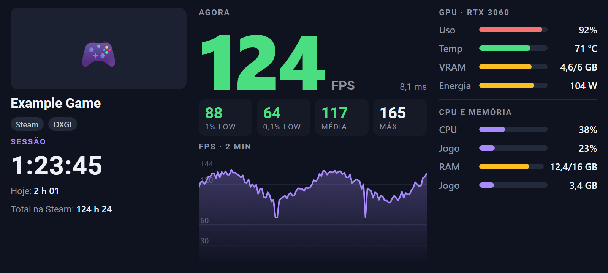

# PhoneBox Games Tab

[English](README.md) · **Português (Brasil)**

Uma página **Games** para o [PhoneBox](https://github.com/ersinkoc/phonebox): enquanto você joga no PC com Windows, o
celular na mesa mostra o FPS ao vivo, o tempo de quadro, 1% / 0,1% low, um gráfico de FPS de 2 minutos, a capa do jogo,
o cronômetro da sessão, o tempo jogado hoje e o uso de GPU / CPU / RAM. Quando você não está jogando, mostra as sessões
recentes e os jogos mais jogados da semana.



> Complemento da comunidade. Não faz parte do PhoneBox e não tem ligação com o autor dele. Usa só a API local pública
> do PhoneBox (`/api/push`, `/api/settings`) e o widget **Custom HTML**, então o app e o agente do PhoneBox não mudam.

## Recursos

- **FPS sem overlay e sem injeção.** Os quadros são contados pelos eventos ETW do próprio Windows, em tempo real
  (DXGI, Direct3D 9 e o kernel do DirectX, que cobre também Vulkan e OpenGL): a mesma base do PresentMon e do
  FrameView. Nada é injetado no jogo, então anti-cheat não entra na história. Funciona em qualquer monitor e GPU.
- **Sabe o que você está jogando.** Steam (nome, capa, horas totais na Steam), Xbox / Game Pass (nome e arte oficiais
  do catálogo da Microsoft Store), Epic, GOG e jogos `.exe` soltos.
- **Tempo de jogo.** Cronômetro da sessão, total de hoje, mais jogados dos últimos 7 dias, sessões recentes com o FPS médio.
- **Abre sozinha.** Uma regra do PhoneBox leva o celular para a aba Games quando um jogo abre e volta quando ele fecha.
- **Suas listas.** Arquivos de texto para incluir ou ignorar programas e para adicionar suas pastas de jogos.
- **Português e inglês**, seguindo o idioma do celular.

## Requisitos

- Windows 10 ou 11 e [PhoneBox](https://github.com/ersinkoc/phonebox) 0.9.24 ou mais novo, com o agente rodando.
- O **.NET 10 SDK** para compilar o coletor (ou o .NET 10 Desktop Runtime, se você usar uma pasta `bin` já compilada).
- Para o FPS, seu usuário do Windows precisa estar no grupo **Usuários de log de desempenho** (depois disso não precisa
  de administrador). Um administrador adiciona uma vez com:

  ```powershell
  Add-LocalGroupMember -SID S-1-5-32-559 -Member $env:USERNAME
  ```

  e depois saia e entre de novo no Windows. Sem isso, tempo de jogo e hardware funcionam e a aba avisa que o FPS está
  indisponível.

## Instalação

Baixe ou clone este repositório e, no PowerShell, com o seu usuário normal do Windows:

```powershell
powershell -ExecutionPolicy Bypass -File .\install.ps1
```

O instalador:

1. compila o coletor em `bin\` (se ainda não estiver lá);
2. descobre a porta do seu agente do PhoneBox (o `--port` do seu `PhoneBoxAgent.exe`, ou 8765), faz backup das
   configurações do PhoneBox em `%LOCALAPPDATA%\PhoneBoxGamesTab\` e adiciona a página **Games** e a regra
   **Game running → Games tab** (`-NoRule` pula a regra);
3. cria a tarefa agendada **PhoneBox Games Tab**, que inicia o coletor no logon, oculto, sem administrador, e o
   reinicia se ele cair.

Abra um jogo para testar. Para remover tudo: `.\install.ps1 -Uninstall`.

## O que conta como jogo

A cada segundo o coletor olha a janela em primeiro plano. Esse programa vira o jogo quando desenha pelo menos
5 quadros por segundo e a primeira regra que se aplica diz sim:

1. `ignore.txt` (ou `ignorar.txt`): nunca é jogo (sempre vence).
2. `include.txt` (ou `incluir.txt`): sempre é jogo.
3. Apps da Microsoft Store / Xbox: só se o catálogo da Store disser que é jogo (WhatsApp, Netflix e parecidos ficam de fora).
4. Pastas de jogos comuns, em qualquer disco: `steamapps\common`, `Epic Games`, `XboxGames`, `GOG Games`,
   `Ubisoft Game Launcher\games`, `EA Games`, `Riot Games`, `Games`, `Jogos`.
5. `folders.txt` (ou `pastas.txt`): qualquer programa dentro das suas pastas de jogos (por exemplo `D:\Jogos`).
6. Tela cheia: uma janela que cobre o monitor inteiro.

Navegadores, Discord, Teams, Wallpaper Engine, launchers e programas parecidos já são ignorados por uma lista interna.
Um item por linha, `#` começa um comentário, `.exe` é opcional. As listas são lidas quando o coletor inicia, então
reinicie-o depois de editar:

```powershell
Stop-ScheduledTask 'PhoneBox Games Tab'; Start-ScheduledTask 'PhoneBox Games Tab'
```

O [guia ilustrado (PDF, inglês e português)](docs/guide.pdf) explica as listas passo a passo.

## Como funciona

```
jogo ──quadros──▶ ETW do Windows ──▶ PhoneBoxGamesTab.exe ──POST /api/push/game (1/s)──▶ agente PhoneBox ──▶ celular
                                              └──────────POST /api/push/playing (ttl 15 s)──▶ regra: abre a aba Games
```

- `collector/`: o coletor (C#, .NET 10, sem pacotes NuGet). Abre uma sessão ETW em tempo real chamada
  `PhoneBoxGamesTab-<usuário>`, conta os eventos `Present` por processo e calcula o FPS pelos intervalos entre quadros.
- `widget/games-widget.html`: o widget Custom HTML. Lê `phonebox.data.push.game` (do coletor) e `phonebox.data.state.pc`
  (CPU, GPU e RAM do próprio PhoneBox).
- O histórico (sessões de 1 minuto ou mais) fica no seu PC, em `%LOCALAPPDATA%\PhoneBoxGamesTab\history.json`.

Opções de linha de comando do `bin\PhoneBoxGamesTab.exe`: `--port <n>`, `--console` (mostra o estado a cada segundo),
`--test` (mostra por 5 segundos o FPS de cada programa que desenha), `--force <exe>` (trata esse programa como o jogo).

## Privacidade

Tudo roda no seu PC e conversa só com o agente do PhoneBox em `127.0.0.1`, exceto:

- **Catálogo da Microsoft Store** (`displaycatalog.mp.microsoft.com`): para apps da Store / Xbox, o coletor envia o nome
  do pacote do app (por exemplo `Editora.Jogo_abc123`) e o idioma e a região de exibição do Windows (por exemplo
  `market=BR&languages=pt-br`) para saber se é jogo e pegar o nome e a arte no seu idioma.
- **Capas** são carregadas pelo celular dos servidores de imagem da Steam e da Microsoft. O endereço de uma capa da
  Steam contém o app ID do jogo, então o servidor de imagens da Steam sabe qual é o jogo.

Nenhuma conta, chave ou arquivo do seu PC é enviado. As consultas acima mostram a esses servidores qual jogo você está
jogando e o idioma e a região do seu Windows.

## Problemas comuns

| Problema | O que fazer |
|---|---|
| Jogo não aparece | Coloque a pasta no `folders.txt` ou o `.exe` no `include.txt`; deixe a janela do jogo na frente. |
| App aparece como jogo | Coloque o `.exe` no `ignore.txt` (as sessões antigas dele saem do histórico no próximo início). |
| "FPS indisponível" | Entre no grupo Usuários de log de desempenho (veja Requisitos) e saia/entre no Windows. |
| Nada atualiza | Confira se a tarefa **PhoneBox Games Tab** está rodando e leia `%LOCALAPPDATA%\PhoneBoxGamesTab\collector.log`. |
| Quais programas desenham? | `bin\PhoneBoxGamesTab.exe --test` |

Limites conhecidos: a Steam grava as horas totais quando o jogo fecha, então durante a sessão a aba soma a sessão atual.
O FPS mostrado é a taxa em que o jogo apresenta quadros (como o "FPS" do PresentMon), não o que um monitor com taxa
variável acaba exibindo.

## Licença

[MIT](LICENSE).
